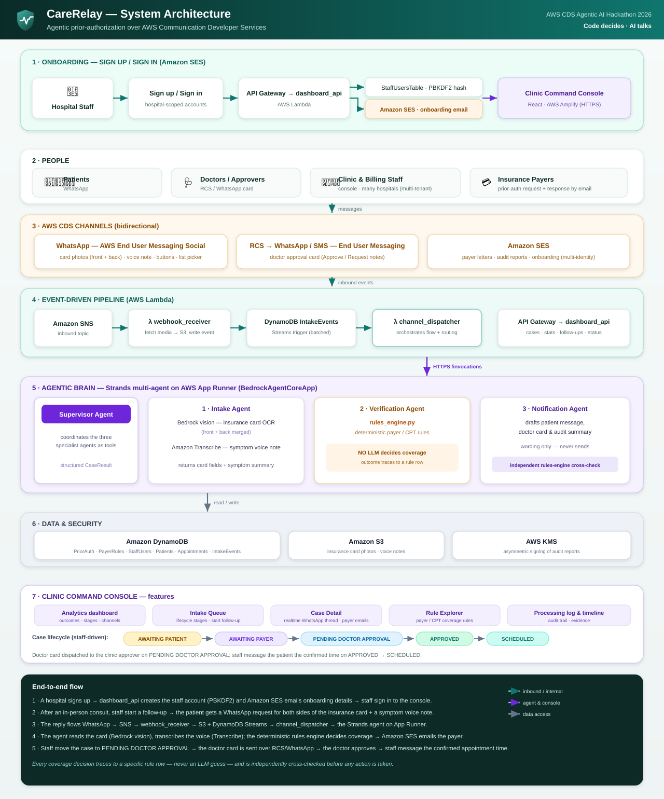
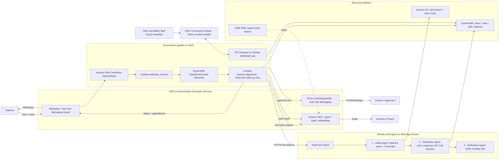

# CareRelay

**Conversational prior-authorization for clinics** — a **Strands multi-agent** system that turns the slow, phone-and-fax prior-authorization process into a simple WhatsApp conversation, powered end-to-end by **AWS Communication Developer Services (CDS)**: WhatsApp and RCS/SMS via **AWS End User Messaging**, and email via **Amazon SES**.

Built for the **AWS CDS Agentic AI Hackathon (2026)**.

---

## The problem

Prior authorization is one of the most expensive administrative burdens in healthcare. When a doctor recommends a procedure, someone on the clinic staff has to confirm the patient's insurance, gather documents, and get the payer's approval — a process that traditionally means phone calls, hold music, faxes, and days of back-and-forth before the patient can even be given an appointment time.

**CareRelay collapses that into a chat.** After an in-person consult, staff start a follow-up from the console. The patient receives a WhatsApp message, replies with a photo of their insurance card and a short voice note describing their symptoms, and the system does the rest: it reads the card, transcribes the voice note, checks the payer's coverage rules, emails the payer a formal request, routes the case to the doctor for approval, and — only once everything clears — releases the confirmed appointment date and time to the patient. The patient never leaves WhatsApp. Staff watch the whole thing happen in real time from a web console.

---

## What CareRelay does, end to end

### The staff-initiated follow-up flow (the core workflow)

This is the authoritative flow, modeled on how a real clinic actually works:

1. **In-person consult.** A patient visits the clinic. The doctor decides they need a future procedure or diagnostic.
2. **Staff start a follow-up** from the console: patient name, WhatsApp number (with country code), the recommended procedure, the intended appointment date/time, and whether the patient has insurance. The appointment time is **stored but withheld** — the patient is not told it yet.
3. **CareRelay reaches out over WhatsApp.**
   - **Insured patients** are asked for a photo of their insurance card **and** a voice note describing their symptoms.
   - **Self-pay patients** are asked for a voice note only.
4. **The patient replies in the chat.** CareRelay acknowledges each message.
5. **The agent pipeline processes the reply** (details below): the insurance card is read by a vision model, the voice note is transcribed, and the payer's coverage rules are evaluated deterministically.
6. **Clearance.**
   - **Insured:** if prior authorization is required, CareRelay emails the payer a formal written request. Once coverage is confirmed, the case is cleared.
   - **Self-pay:** the case is routed to the doctor, who approves (or requests more detail) with a one-tap action card.
7. **The appointment is released.** Only now does the patient receive a WhatsApp message with their confirmed date, time, and visit instructions.

Throughout, **the appointment date/time is never revealed until the case clears** — this mirrors real clinic policy and is a deliberate design choice.

### Three communication channels, one case

| Channel | AWS CDS service | Who it reaches | What it carries |
|---|---|---|---|
| **WhatsApp** | AWS End User Messaging Social | Patients | Document/voice requests, acknowledgements, status updates, interactive buttons and list pickers, and the final appointment confirmation |
| **RCS** (falls back to WhatsApp/SMS) | AWS End User Messaging | Doctors / approvers | A rich approval card with Approve / Request-Notes actions, enriched with the patient's symptoms, payer, procedure, and the matched coverage rule |
| **Email** | Amazon SES | Payers and clinic staff | Formal prior-authorization request letters to payers, case audit reports to staff, and hospital onboarding emails |

CareRelay is **channel-adaptive**: it sends the doctor a native RCS rich card where AWS supports RCS, and automatically falls back to WhatsApp interactive buttons where it doesn't (for example, India), so the card always lands on a channel that actually works for that recipient.

---

## Multi-agent architecture (Strands)

A **Supervisor** agent coordinates three specialist agents using Strands' "agents as tools" pattern — each specialist is a plain Strands `Agent` passed directly into the supervisor's `tools` list:

```
Supervisor (carerelay_supervisor)
  │
  ├─ 1. Intake Agent        -> extract_insurance_card (Bedrock vision)
  │                             + transcribe_voice_note (Amazon Transcribe)
  │                             returns: card fields (payer, member ID, group),
  │                                      symptom summary from the voice note
  │
  ├─ 2. Verification Agent  -> check_prior_auth (rules_engine.py, deterministic)
  │                             returns: outcome, missing documents, matched rule,
  │                                      rationale  (ground truth — never altered)
  │
  └─ 3. Notification Agent  -> draft_patient_message, draft_doctor_approval_card,
                                draft_audit_summary
                                (drafts wording only — never sends anything itself)
```

The supervisor's output is constrained to a structured `CaseResult` schema (`agent_app/schemas.py`) — the agent cannot return free-text prose as its final answer.

### "Code decides, AI talks"

This is CareRelay's central design principle, and it's enforced, not just promised:

- **`agent_app/rules_engine.py`** is a plain-Python rule evaluator over the payer rules table (payer + CPT → requires-prior-auth / required documents). **No LLM ever decides coverage.** The Verification Agent's tool calls this engine and returns its result verbatim.
- **`agent_app/main.py` independently re-runs the rules engine** against whatever outcome the agent reported (`_verify_against_rules_engine`) and **rejects** the result if the model's narration doesn't match what the deterministic engine actually computed. This guards against a model fabricating a rule citation or outcome.

The language model is used only to *extract* (read a card, transcribe a voice note) and to *phrase* (draft the patient/doctor/audit messages). Every coverage decision traces to a specific row in the rules table — auditable as data, in the console's Rule Explorer.

---

## Architecture



> The full-resolution diagram is at [`docs/architecture.svg`](docs/architecture.svg). A text-rendered version follows for platforms that don't display SVG inline.



CareRelay runs as a fully event-driven pipeline on real AWS infrastructure.

**Services used:**

- **AWS End User Messaging (Social + SMS/RCS)** — WhatsApp patient channel and RCS/SMS doctor channel.
- **Amazon SES** — payer request letters, audit reports, onboarding emails.
- **Amazon Bedrock** — the vision model for insurance-card extraction and the language model for message drafting (never for decisions).
- **Amazon Transcribe** — voice-note speech-to-text.
- **AWS App Runner** — hosts the containerized Strands agent (`BedrockAgentCoreApp`), auto-scaled with managed HTTPS. The same container image is AgentCore-Runtime-compatible, so it can move to Bedrock AgentCore Runtime unchanged.
- **Amazon ECR** — stores the agent container image.
- **AWS Lambda** — `webhook_receiver`, `channel_dispatcher`, `dashboard_api`.
- **Amazon API Gateway** — REST API in front of the dashboard Lambda.
- **Amazon DynamoDB (+ Streams)** — case data, payer rules, staff users, patients, intake events, appointments; the stream drives the event pipeline.
- **Amazon S3** — insurance card photos and voice notes.
- **Amazon SNS** — the inbound event destination that fans WhatsApp events out to the webhook Lambda.
- **AWS Amplify Hosting** — serves the staff web console over HTTPS.
- **AWS KMS** — asymmetric signing of audit reports for tamper-evidence.

---

## The staff web console ("Clinic Command Console")

A React + TypeScript single-page app that gives clinic staff a live, auditable view of every case. Patients never see this — it's the operational cockpit for the clinic.

**Views:**

- **Analytics (home)** — outcome breakdown, case lifecycle stages, most-missing documents, channel mix, and extraction-confidence metrics.
- **Intake Queue** — a live, searchable, filterable list of all cases, grouped into clear lifecycle stages (Awaiting patient → Pending approval → Scheduled → Denied) with per-stage counts. The **Start follow-up** action launches the core workflow.
- **Case Detail** — four focused tabs:
  - **Conversations** — a **real-time, WhatsApp-styled conversation thread** showing exactly what the patient sent and received (text, voice notes, card photos), with read receipts and the verified-business badge, plus a staff reply composer and the doctor approval card.
  - **Payer emails** — the full hospital ↔ payer email correspondence (the request sent and the payer's response) with timestamps.
  - **Processing log** — the step-by-step record of what happened to the case (documents captured, coverage checked, notifications sent), with the deterministic rule citation highlighted.
  - **Timeline & evidence** — the case activity timeline, the extracted insurance-card fields, the captured voice/photo evidence, and the audit email.

The console polls every few seconds, so the WhatsApp thread, case status, and payer correspondence update live as a patient replies.

---

## Multi-tenancy — built for many hospitals, many identities

CareRelay is designed as a **multi-hospital platform**, not a single-clinic tool:

- **Hospital-scoped accounts.** Each hospital registers through the console (name, address, contact email, contact phone) and receives a generated alphanumeric Hospital ID. Staff sign in with their Hospital ID + username + password (passwords hashed with PBKDF2-HMAC-SHA256). Multiple hospitals coexist, each with their own staff.
- **Per-case hospital tagging.** When a hospital's staff start a follow-up, the patient is associated with that hospital. Later WhatsApp replies are routed and tagged to the correct hospital, so the payer letter, audit email, and console all reflect the owning hospital's name — resolved dynamically per case, never hardcoded.
- **Multiple sender identities and numbers.** The messaging layer is parameterized, not fixed to one address or number. Each hospital can register its own SES sender identities and recipient inboxes, and WhatsApp/RCS/SMS origination identities are configured per deployment. Payer inboxes, clinic approver numbers, and audit recipients are all lists — a deployment can fan a single case out to several payer or staff addresses, and different hospitals can use entirely separate communication identities.
- **Per-recipient channel resolution.** Doctor approver numbers are stored with country codes, and CareRelay chooses the right channel (RCS vs WhatsApp vs SMS) per number based on where each service is supported.

---

## Repository layout

```
agent_app/                 Strands multi-agent backend (containerized; runs on App Runner / AgentCore)
  agents/                  supervisor.py, intake_agent.py, verification_agent.py, notification_agent.py
  tools/                   documents.py (vision card extraction + Transcribe), messaging.py, verification.py
  rules_engine.py          Deterministic payer/CPT coverage rules (no model in the loop)
  schemas.py               CaseResult / ExtractedCard / VerificationResult — the agent's structured contract
  main.py                  HTTP entrypoint (BedrockAgentCoreApp) + independent rules-engine cross-check
  Dockerfile               linux/amd64 container image (built from repo root)

lambdas/
  common/                  Shared config, AWS client builders, channel senders (WhatsApp/RCS/SMS/SES),
                           transcript + patient-directory helpers
  webhook_receiver/        Receives WhatsApp events from SNS, fetches media to S3, writes DynamoDB
  channel_dispatcher/      DynamoDB Stream consumer -> invokes the agent -> sends WhatsApp replies,
                           RCS/WhatsApp doctor cards, and SES payer/audit emails; drives the follow-up flow
  dashboard_api/           Case/stats API, hospital-scoped staff signup/login, follow-up initiation,
                           staff messaging, payer-email + transcript exposure, onboarding email

cdk/                       AWS CDK v2 (Python) — StorageStack, MessagingStack, ComputeStack (IaC reference)
frontend/                  React + TypeScript + Vite staff console (deployed on AWS Amplify)
scripts/                   Idempotent boto3 deploy/setup/test utilities (see below)
seed/                      Demo payer rules, staff accounts, pharmacies
```

---

## Quick start

Prerequisites: Python 3.11+, Node.js 18+, Docker (for building the agent image), AWS credentials.

```bash
# 1. Backend deps
python -m venv venv
venv\Scripts\Activate.ps1          # Windows (bash: source venv/bin/activate)
pip install -r requirements.txt

# 2. Configure
cp .env.example .env               # fill in AWS creds, Bedrock model id, messaging identities, table names

# 3. Frontend deps
cd frontend && npm install && npm run build
```

### Try the console with zero AWS setup

```bash
cd frontend && npm run dev
```

Open `http://localhost:5173`. The app ships with realistic mock data covering every case outcome, so it's fully explorable out of the box.

### Run the agent pipeline locally (no deploy)

```bash
python scripts/local_pipeline_test.py
```

Runs the full Strands supervisor + rules engine against a sample case entirely on your machine.

---

## Deploying to AWS

All deploy scripts are idempotent (safe to re-run) and live in `scripts/`. They provision resources directly via boto3.

```bash
# --- Data stores ---
python scripts/setup_auth_infra.py          # StaffUsersTable + SES sender identity
python scripts/setup_case_infra.py          # PriorAuthTable + PayerRulesTable
python scripts/setup_intake_infra.py        # IntakeEventsTable (streamed) + PatientsTable
python scripts/setup_appointments_infra.py  # AppointmentsTable
python scripts/seed_payer_rules.py          # seed payer/CPT coverage rules
python scripts/seed_staff_users.py          # seed demo staff logins

# --- Dashboard API + console backend ---
python scripts/deploy_dashboard_api.py      # Lambda: CareRelay-DashboardApi
python scripts/deploy_api_gateway.py        # API Gateway REST API (prints the base URL)

# --- Inbound WhatsApp pipeline ---
python scripts/setup_sns_topic.py           # CareRelay-InboundTopic
python scripts/deploy_webhook_receiver.py   # Lambda: CareRelay-WebhookReceiver
python scripts/subscribe_webhook_to_sns.py  # subscribe the webhook to the topic

# --- The Strands agent (container) ---
python scripts/push_agent_ecr.py            # build + push the agent image to Amazon ECR
python scripts/deploy_app_runner.py         # run the agent on AWS App Runner, inject config, print URL
python scripts/deploy_channel_dispatcher.py # Lambda: CareRelay-ChannelDispatcher (calls the agent)

# --- Staff web console ---
python scripts/deploy_frontend.py           # build + deploy the React console to AWS Amplify (prints URL)
```

**Linking a WhatsApp Business Account** is a one-time console step (it requires a Meta Business account and phone-number verification, which can't be scripted): in **AWS End User Messaging Social**, onboard a WhatsApp Business Account and add a **message and event destination** pointing at the `CareRelay-InboundTopic` SNS ARN. After that, real inbound WhatsApp messages flow through the pipeline automatically.

> The agent container is both **App Runner-ready** and **Bedrock AgentCore Runtime-ready** — the same image exposes the `/ping` and `/invocations` contract. `channel_dispatcher` calls the App Runner URL by default (`AGENT_RUNNER_URL`) and will use a Bedrock AgentCore Runtime ARN (`AGENT_RUNTIME_ARN`) instead if one is set, with no code changes.

---

## Security

- Staff passwords are hashed with **PBKDF2-HMAC-SHA256** (260,000 iterations); plaintext is never stored.
- Patient phone numbers are **pre-masked at write time**; the dashboard API never returns a raw number. The raw number is stored write-only, solely so staff can reply over WhatsApp.
- Audit report emails are **signed with an asymmetric AWS KMS key** (RSASSA_PKCS1_V1_5_SHA_256) so recipients can verify a report wasn't altered (enabled when a signing key is configured).
- External content (messages, media, web results) is treated as untrusted input; the agent's output is independently cross-checked against the deterministic rules engine before it's acted on.
- The demo dashboard API is unauthenticated for convenience — add a Cognito/Lambda authorizer before any production use. This is documented in-code rather than left as an unstated gap.

---

## License

MIT. See [`LICENSE`](LICENSE).
